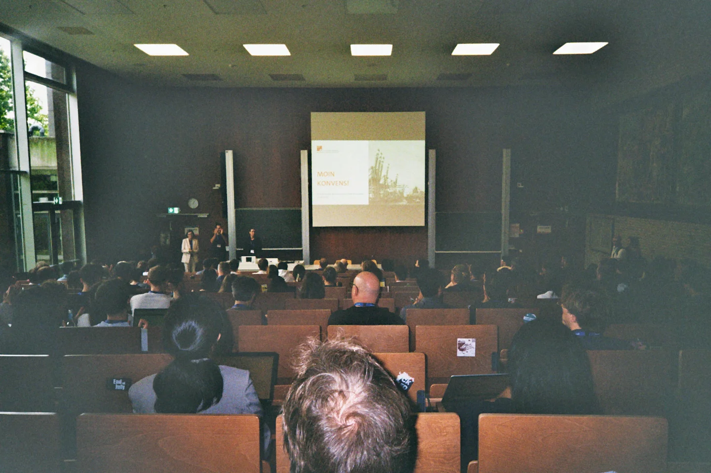

# KONVENS 2027 @ Trier University

**save the date: KW36, Sep. 06 to 09, 2027**

---

## Linguistic Diversity in a World of Synthetic Text

KONVENS 2027 will be held amid the emergence of language models and their ability to produce synthetic text at unprecedented scale. How is this new category changing linguistic diversity, and how can computational linguistics find and analyze patterns in this novel category of content? We aim to provide the grounds for developing and exchanging ideas for attribution of text using explainable linguistic measurements, for describing patterns that set synthetic language apart from human language at the lexical, morphosyntactic, semantic, and pragmatic levels, and for assessing what is at stake when generated text flows back into the corpora, platforms, and research instruments our field relies on.

Linguistic fluency shown by language models does not equal ecological validity. Generated text tends to be more polished, regular, and normative than the language people actually use: it smooths away the abbreviations, typos, and informal constructions of discourse. Instruction-tuned models, for instance, gravitate toward an informationally dense, noun-heavy register and fail to reproduce the stylistic variation that separates genres, and even lexical-semantic regularities such as Martin's Law hold only within a narrow window of training. Computational linguistics has developed methods to describe these differences transparently rather than leaving the distinction between human and machine text to black-box detectors, which generalize poorly to unseen domains, generators, and adversarial rewrites. The same holds when language models are used as research instruments: as annotators, as simulated social media users, or as survey respondents, their outputs need to be benchmarked against authentic human data before they can stand in for it.

Beyond attributing synthetic texts, contemporary research describes how models compress dialects, sociolects, minority perspectives, and smaller language communities into a fluent but homogeneous default. That default becomes training data and reference material, and recursive training on model output measurably reduces lexical, syntactic, and semantic diversity and erases the tails of the original distribution. Thus, linguistic diversity may narrow in ways that are hard to see and harder to reverse. Orthographic and lexical variation in small, semi-standardised languages is systematic structure rather than noise, and it is precisely this structure that a homogeneous default overwrites. Validation done in English does not carry over to other languages: low-resource languages need dedicated resources and models, and LLMs still struggle with socially loaded discourse in them. This makes our multilingual and linguistically focused community a fitting place for this discussion. And Trier, at the meeting point of German, Luxembourgish, Belgian, and French, is a melting pot for languages and cultures, where language choice itself carries questions of identity and belonging.

---

*more to follow soon. In the meantime, have a look at pictures from 2026:*

